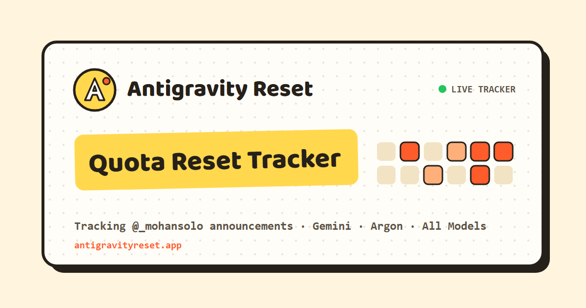

# Antigravity Reset

[](https://antigravityreset.app)
[](https://registry.modelcontextprotocol.io/v0.1/servers/app.antigravityreset%2Fantigravity-reset/versions/latest)
[](https://github.com/guaguaguaxia/antigravity_reset/actions/workflows/deploy.yml)
[](./LICENSE)
[](https://antigravityreset.app/api/docs)

**English** | [简体中文](./README.zh-CN.md)

Live quota reset tracker, historical heatmap, interval analytics, free public API, RSS/Markdown feeds, and a zero-auth remote MCP server for **Google Antigravity** (tracking official announcements from [`@_mohansolo`](https://x.com/_mohansolo)).



---

## Live Site (5 Languages)

The root path (`/`) automatically detects your `Accept-Language` and persisted cookie preference while keeping clean canonical URLs for search engines:

- **English**: https://antigravityreset.app/
- **简体中文**: https://antigravityreset.app/zh-CN
- **繁體中文**: https://antigravityreset.app/zh-TW
- **日本語**: https://antigravityreset.app/ja
- **한국어**: https://antigravityreset.app/ko

---

## Zero-Auth Remote MCP Server

Published on the **Official MCP Registry** as [`app.antigravityreset/antigravity-reset`](https://registry.modelcontextprotocol.io/v0.1/servers/app.antigravityreset%2Fantigravity-reset/versions/latest) (`websiteUrl`: `https://antigravityreset.app`).

Add the Streamable HTTP endpoint to Claude, Cursor, Windsurf, VS Code, or Antigravity with zero authentication required:

```json
{
  "mcpServers": {
    "antigravity-reset": {
      "type": "streamable-http",
      "url": "https://antigravityreset.app/mcp"
    }
  }
}
```

### Exposed Tools (Read-Only)

| Tool | Description | Arguments |
| :--- | :--- | :--- |
| `get_latest_reset` | Latest reset announcement, elapsed hours/days, and stats | `locale?` (`en`, `zh-CN`, `zh-TW`, `ja`, `ko`) |
| `list_resets` | Filter reset history by model or scope | `locale?`, `model?`, `reset_type?` (`regular` \| `all`), `limit?` |
| `search_resets` | Full-text search across English & localized announcements | `query`, `locale?` |
| `get_reset_stats` | Total resets, average interval, longest wait, model breakdown | — |

### Exposed Resources

- `antigravity://resets/latest.json` (`application/json`)
- `antigravity://resets/summary.md` (`text/markdown`)
- `antigravity://resets/summary.zh-CN.md` (`text/markdown`)

---

## Free Public Data Endpoints

All read endpoints are open, CORS-enabled, and require no API key. For full documentation, see [antigravityreset.app/api/docs](https://antigravityreset.app/api/docs) (or localized docs at `/zh-CN/api/docs`, `/zh-TW/api/docs`, `/ja/api/docs`, `/ko/api/docs`).

| Endpoint | Format | Description |
| :--- | :--- | :--- |
| `GET /api/resets?locale=en` | JSON | Normalized reset history, permalinks, stats, and monitor metadata |
| `GET /api/resets/{id}?locale=en` | JSON | Single reset event, interval since previous reset, and prev/next IDs |
| `GET /openapi.json` · `/openapi/v1/openapi.json` | OpenAPI 3.1 | Machine-readable OpenAPI specification |
| `GET /resets/{id}` · `/{locale}/resets/{id}` | HTML | Permanent localized detail pages for each reset announcement |
| `GET /feed.xml` (`?locale=`) | RSS 2.0 | Standard RSS feed linking to canonical event pages |
| `GET /en.md` · `/zh-CN.md` · `/zh-TW.md` · `/ja.md` · `/ko.md` | Markdown | Agent-friendly localized summary |
| `GET /SKILL.md` | Markdown | Hosted portable Agent Skill |
| `GET /llms.txt` | Text | `llmstxt.org` site and dataset index for AI crawlers |
| `GET /badge.svg` (`?label=`) | SVG | Live status badge for READMEs and blog posts |
| `GET /api/docs` (`/{locale}/api/docs`) | HTML | Localized public API, MCP, and attribution documentation |

### Attribution / Live Status Badge

If you use the free API or MCP data in a dashboard or article, please link back to [`antigravityreset.app`](https://antigravityreset.app/) or embed the live SVG status badge:

```html
Data from <a href="https://antigravityreset.app/">Antigravity Reset</a>
```

```markdown
[](https://antigravityreset.app/)
```

---

## Agent Skill

This repository includes a portable Agent Skill at [`skills/antigravity-reset/SKILL.md`](./skills/antigravity-reset/SKILL.md) (also hosted live at [`https://antigravityreset.app/SKILL.md`](https://antigravityreset.app/SKILL.md)) so AI coding agents can check whether Google Antigravity quotas were recently reset before planning heavy workloads.

---

## Architecture & Local Development

- **Runtime**: Cloudflare Workers + Workers KV (`ANTIGRAVITY_KV`) + Static Assets (`public/`)
- **SSR & i18n**: Server-rendered neo-brutalist HTML across 5 locales, with Mohan time (`America/Los_Angeles`) vs local time switcher, 28-week heatmap, permanent `/resets/:id` detail pages, reaction counter, live visitor count, and Article/BreadcrumbList/FAQPage/Dataset JSON-LD
- **Real-Time Ingestion & Alerts**: `POST /api/webhook/x` accepts X webhooks (TwitterAPI.io / SocialData.tools / generic JSON), classifies reset announcements + generates 4-language translations via APIMart (`gpt-6-luna`), updates KV live, and optionally broadcasts to a Telegram channel when `TELEGRAM_BOT_TOKEN` + `TELEGRAM_CHAT_ID` secrets are configured
- **CI/CD**: Automatic typecheck, Vitest suite, and Wrangler deploy via `.github/workflows/deploy.yml`

```bash
npm install
npm run dev         # Start local Wrangler dev server
npm run typecheck   # Run TypeScript check
npm test            # Run Vitest unit tests
```

---

## Disclaimer

Independent community tracker aggregating public posts from `@_mohansolo` on X. Not affiliated with Google.
