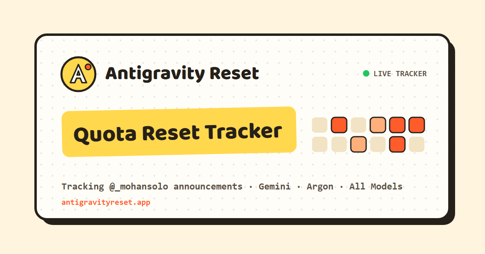

# Antigravity Reset

[](https://antigravityreset.app/zh-CN)
[](https://registry.modelcontextprotocol.io/v0.1/servers/app.antigravityreset%2Fantigravity-reset/versions/latest)
[](https://github.com/guaguaguaxia/antigravity_reset/actions/workflows/deploy.yml)
[](./LICENSE)
[](https://antigravityreset.app/api/docs)

[English](./README.md) | **简体中文**

专为 **Google Antigravity** 打造的实时额度重置追踪站（整理自 [`@_mohansolo`](https://x.com/_mohansolo) 在 X 发布的官方公告），提供多语言界面、28 周重置热力图、平均间隔统计、免费公开 JSON API / RSS / Markdown 订阅，以及免鉴权远程 MCP 服务。



---

## 在线访问（5 种语言，支持自动识别）

访问根路径 `/` 会自动根据浏览器的 `Accept-Language` 与 Cookie 偏好分流，同时保留独立的规范链接：

- **简体中文**：https://antigravityreset.app/zh-CN
- **繁體中文**：https://antigravityreset.app/zh-TW
- **English**：https://antigravityreset.app/
- **日本語**：https://antigravityreset.app/ja
- **한국어**：https://antigravityreset.app/ko

---

## 免鉴权远程 MCP 服务

已在 **官方 MCP Registry** 注册上线：[`app.antigravityreset/antigravity-reset`](https://registry.modelcontextprotocol.io/v0.1/servers/app.antigravityreset%2Fantigravity-reset/versions/latest)（`websiteUrl`: `https://antigravityreset.app`）。

无需任何 API Key，可直接在 Claude、Cursor、Windsurf、VS Code 或 Antigravity 中配置远程 Streamable HTTP MCP：

```json
{
  "mcpServers": {
    "antigravity-reset": {
      "type": "streamable-http",
      "url": "https://antigravityreset.app/mcp"
    }
  }
}
```

### 提供的只读 Tools

| Tool | 说明 | 参数 |
| :--- | :--- | :--- |
| `get_latest_reset` | 获取最新一次重置公告、距今小时/天数与统计数据 | `locale?`（`en`、`zh-CN`、`zh-TW`、`ja`、`ko`） |
| `list_resets` | 按模型名称或重置范围筛选历史公告 | `locale?`、`model?`、`reset_type?`（`regular` \| `all`）、`limit?` |
| `search_resets` | 按关键词搜索英文原文、译文和模型标签 | `query`、`locale?` |
| `get_reset_stats` | 获取总次数、平均重置间隔、最长等待天数与模型分布 | — |

### 提供的 Resources

- `antigravity://resets/latest.json`（`application/json`）
- `antigravity://resets/summary.md`（`text/markdown`）
- `antigravity://resets/summary.zh-CN.md`（`text/markdown`）

---

## 免费公开数据接口

所有读取接口完全免费、已开启 CORS，无需 API Key。完整接口文档见 [antigravityreset.app/api/docs](https://antigravityreset.app/api/docs)。

| 接口路径 | 格式 | 说明 |
| :--- | :--- | :--- |
| `GET /api/resets?locale=zh-CN` | JSON | 指定语言的重置历史记录、统计指标与监控状态 |
| `GET /feed.xml` | RSS 2.0 | 标准 RSS 订阅源 |
| `GET /zh-CN.md` · `/zh-TW.md` · `/en.md` · `/ja.md` · `/ko.md` | Markdown | 适合 AI / 脚本直接抓取的本地化摘要 |
| `GET /api/docs` | HTML | 公开 API、MCP 与署名回链文档 |

### 署名引用与徽章

如果你在自己的工具站、看板或文章中引用了本站数据，欢迎加上反向链接指向 [`antigravityreset.app`](https://antigravityreset.app/)：

```html
Data from <a href="https://antigravityreset.app/">Antigravity Reset</a>
```

```markdown
[](https://antigravityreset.app/)
```

---

## Agent Skill

仓库内置了 [`skills/antigravity-reset/SKILL.md`](./skills/antigravity-reset/SKILL.md)，方便各类 AI Coding Agent 在规划重度任务前直接查询 Antigravity 最近是否有额度重置。

---

## 技术架构与本地开发

- **部署架构**：Cloudflare Workers + Workers KV (`ANTIGRAVITY_KV`) + 静态资源托管
- **实时同步与多语言 AI 判定**：`POST /api/webhook/x` 接收来自 X 的 Webhook 推送（兼容 TwitterAPI.io / SocialData.tools / 通用 JSON），调用 AI 自动判定是否为有效重置公告并生成繁/简/日/韩 4 语译文实时写入 KV
- **自动发布**：GitHub Actions（`.github/workflows/deploy.yml`）在推送至 `main` 后自动执行类型检查、Vitest 单元测试并部署至 Cloudflare Workers

```bash
npm install
npm run dev         # 启动本地 Wrangler 调试服务
npm run typecheck   # TypeScript 类型检查
npm test            # 运行 Vitest 单元测试
```

---

## 免责声明

本站为独立社区追踪项目，数据整理自 `@_mohansolo` 在 X 发布的公开公告，与 Google 无关联。
